<p align="center">
  
</p>

## About me

I'm a final-year Computer Science student at the University of Pretoria. I got into computing through games, and what keeps me here is wanting to understand how things really work and then build something people can use. My biggest interests right now are **AI** and **cybersecurity**, two fast-moving fields that are becoming essential to how modern software is built and defended.

I like leading teams and I like explaining things, which is why I'm also a teaching assistant.

- **Teaching Assistant**, University of Pretoria: Data Structures (COS 212) and Netcentrics (COS 216)
- **Cordwalles IT**: building Transit360, a real-time school bus tracking system, with the Head of IT at Cordwalles Preparatory School for Boys
- **Final-year capstone**: OptiLifts, an AI-driven workout platform with an industry client
- **Team lead** on university projects, including a team of 50
- **14 distinctions** so far, with a top mark of 90% in Computer Graphics
- Open to graduate and junior developer opportunities

<p align="center"></p>

## Featured work

| Project | What it is | Built with |
| :-- | :-- | :-- |
| **[OptiLifts](https://github.com/COS301-SE-2026/OptiLifts)**<br>[live app](https://app.optilifts.app/) | A workout platform that adapts your training before and during each session, with computer-vision form analysis and head-to-head training duels. A team of five built it for an industry client; 388 of its commits are mine. | React, ASP.NET Core, FastAPI, PostgreSQL, Azure, Pulumi, Docker, GitHub Actions |
| **[Crossillion](https://github.com/AlessandroParavano/crossillion)**<br>[play it](https://alessandroparavano.github.io/crossillion/) | A daily trivia game where the rarer your answer, the deeper you sink through five zones. Rarity comes from real Wikipedia pageview data, and the music and sound effects are synthesised live in the browser. | JavaScript, Web Audio API, Python |
| **[Templanter](https://github.com/AlessandroParavano/TemplanterProject)** | A plant nursery business simulator that applies 11 design patterns (Singleton, Factory, Observer, State, Memento and more) in a real, playable program. | C++, raylib |
| **Transit360** *(private)* | Real-time school bus tracking with live maps, attendance, pickup and drop-off management, parent notifications and an admin dashboard. Built for Cordwalles Preparatory School. | Node.js, PostgreSQL, Socket.IO, React, React Native (Expo) |
| **SPL compiler** *(private)* | A lexer and parser for a course language, written in plain Java 21 with no libraries. It pinpoints a syntax error, what it expected and how to fix it, or writes out the full syntax tree. | Java |

<p align="center"></p>

## Academics

<p align="center">
  
</p>

My strongest results are in systems, theory and graphics: **90% in Computer Graphics**, 87% in Theoretical Computer Science, 85% in Computer Organisation & Architecture, and 84% in both Data Structures & Algorithms and Netcentric Computer Systems, the two modules I now tutor. My yearly average has gone from 65 to 78, with 14 distinctions so far.

### My degree, as a graph

<p align="center">
  
</p>

The whole graph is also available as a [Neo4j import script](data/modules.cypher).

> Let's start establishing our relationship like Neo4j does.

```cypher
MATCH (me:Developer {name: "Alessandro"}), (you:Team {hiring: true})
MERGE (me)-[:WORKS_WITH {since: "day one"}]->(you)
RETURN me, you;
```

### Where the modules show up in my work

| Module | In practice |
| :-- | :-- |
| **Computer Graphics** (COS 344), 90% | OpenGL graphics assignments in C++ |
| **Data Structures & Algorithms** (COS 212), 84% | Teaching assistant for this module, running the Java practicals |
| **Netcentric Computer Systems** (COS 216), 84% | Teaching assistant: helping students build a full-stack website, and marking |
| **Artificial Intelligence** (COS 314), 75% | Genetic programming in Java: decision-tree and arithmetic evolved programs |
| **Software Modelling** (COS 214) | [Templanter](https://github.com/AlessandroParavano/TemplanterProject), a C++ simulator using 11 design patterns |
| **Software Engineering** (COS 301), in progress | [OptiLifts](https://github.com/COS301-SE-2026/OptiLifts) with an industry client |
| **Compiler Construction** (COS 341), in progress | A lexer and parser for a course language, in plain Java 21 |
| **Computer Security & Ethics** (COS 330), in progress | Honeypot labs: a fake FTP server in Python that logs what attackers try |

<p align="center"></p>

## Toolbox

<p>
  
  
  
  
  
  
  
  <br>
  
  
  
  
  
  
  <br>
  
  
  
  
  
  
  
</p>

**How I work:** I like teams where people explain their thinking, ask questions and refine an idea until it holds up. I've been team lead on university projects, including a team of 50, and I enjoy the problem-solving that comes with real constraints such as live data, real users and changing requirements.

<p align="center"></p>

## Contributions

<p align="center">
  <picture>
    <source media="(prefers-color-scheme: dark)" srcset="https://raw.githubusercontent.com/AlessandroParavano/AlessandroParavano/output/github-snake-dark.svg">
    
  </picture>
</p>

## Elsewhere

Outside the code: padel, golf, the gym and a steady supply of books.

[](https://www.linkedin.com/in/aleparavano)
